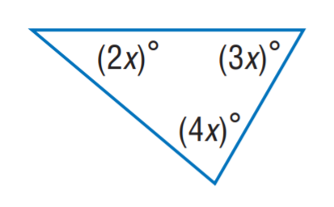
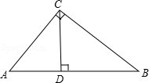
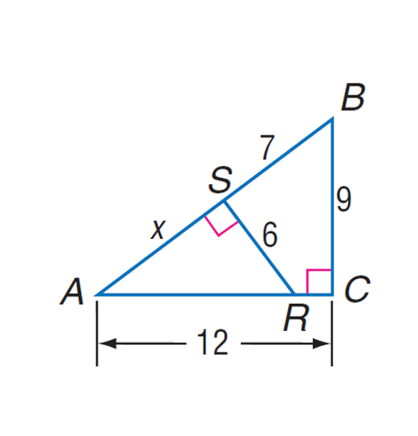
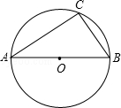
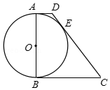
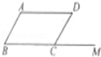

# 六个代表性增失案例

以下6例来自主使用条件的18个开发增失案例。正式严格评分保持不变；这些案例只解释分数变化的来源，不估计全开发集的过程正确率。正文中的回答为实际模型输出，可能包含错误。

## validation_0263 — format_only_gain

训练组：`direct`；评估：`dev_direct`；严格评分变化：`gained`。



Find $x$.

参考：`20`。

**before**（final，实际工具调用0次）：

```text
The sum of the angles in a triangle is 180°. So, we have 2x + 3x + 4x = 180. This simplifies to 9x = 180. Dividing both sides by 9 gives x = 20. Answer: 20
```

**round64**（final，实际工具调用0次）：

```text
The sum of the angles in a triangle is 180°. So, we have 2x + 3x + 4x = 180. This simplifies to 9x = 180. Dividing both sides by 9 gives x = 20.
Answer: 20
```

**复核：** 前后均正确由2x+3x+4x=180得20；新输出仅将Answer独立成行。

## geo170k_2875 — reasoning_correction_gain

训练组：`direct`；评估：`dev_direct`；严格评分变化：`gained`。



First perform reasoning, then finally select the answer from the choices in the following format: Answer: xxx.
Question: If CD is the height on the hypotenuse of right triangle ABC, and AB measures 5.0 while AC measures 3.0, what is the tangent of angle BCD?
Choices:
A: \frac{4}{3}
B: \frac{3}{4}
C: \frac{4}{5}
D: \frac{3}{5}

参考：`A`。

**before**（final，实际工具调用0次）：

```text
In right triangle ABC, AB = 5, AC = 3. Therefore, BC = √(AB^2 - AC^2) = 4. In right triangle BCD, CD = AC = 3. Therefore, tan(∠BCD) = CD / BC = 3 / 4.
Answer: B
```

**round64**（final，实际工具调用0次）：

```text
In right triangle ABC, AB = 5, AC = 3. Therefore, BC = 4. In right triangle BCD, angle BCD = angle A, so tan angle BCD = tan angle A = BC / AC = 4 / 3.
Answer: A
```

**复核：** 旧输出错设CD=AC并取倒比；新输出正确利用∠BCD=∠A，BC4/AC3得到4/3。

## validation_0074 — endpoint_gain_with_wrong_reasoning

训练组：`direct`；评估：`dev_direct`；严格评分变化：`gained`。



Find AB

参考：`15`。

**before**（final，实际工具调用0次）：

```text
Triangle ABC is a right triangle with AC = 12, BC = 9, and RS = 6. Triangle ASR is similar to triangle ABC, so AS/AC = RS/BC. AS = 12 - x, so (12 - x)/12 = 6/9. x = 8. AB = 10.
```

**round64**（final，实际工具调用0次）：

```text
Triangle ABC is a right triangle with AC = 12, BC = 9, and RS = 6. Triangle ASR is similar to triangle ABC, so AS/AC = RS/BC. AS = 12 - x, so (12 - x)/12 = 6/9. x = 8. AB = 7 + 8 = 15.
Answer: 15
```

**复核：** 新答15正确，但把AS写为12-x错误，(12-x)/12=6/9应得x=4而非8。正确关系是AS/AC=RS/BC，x/12=6/9得AS8，再加SB7；不能认可实际输出的推导。

## geo170k_8668 — reasoning_correction_gain_no_tool

训练组：`tool`；评估：`dev_tool`；严格评分变化：`gained`。



First perform reasoning, then finally select the answer from the choices in the following format: Answer: xxx.
Question: How much does angle A measure in circle O if AB is the diameter, and point C is located on the circle, with angle B equaling 60.0 degrees?
Choices:
A: 80°
B: 50°
C: 40°
D: 30°

参考：`D`。

**before**（final，实际工具调用0次）：

```text
In a circle, if AB is the diameter and angle B is 60 degrees, then angle A is half of angle B because the angle subtended by a diameter is a right angle (90 degrees). Therefore, angle A is 45 degrees. Answer: 45.0
```

**round64**（final，实际工具调用0次）：

```text
In a circle, if AB is the diameter, then angle ACB is a right angle (90 degrees). Since angle B is 60 degrees, angle A is 90 degrees - 60 degrees = 30 degrees. Therefore, angle A measures 30 degrees.

Answer: D
```

**复核：** 新正确使用直径对圆周角90°再减60°得30°；无调用。

## geo170k_5504 — endpoint_gain_with_wrong_reasoning_no_tool

训练组：`tool`；评估：`dev_tool`；严格评分变化：`gained`。



First perform reasoning, then finally select the answer from the choices in the following format: Answer: xxx.
Question: In the given figure, AB is the diameter of circle O, and AD, BC, and CD are tangents to circle O at points A, B, and E respectively. If AD = 10.0, BC = 40.0, then what is the value of AB?
Choices:
A: \frac{5}{2}
B: 30.0
C: 40.0
D: 50.0

参考：`C`。

**before**（stopped_single_terminal_python_block_required，实际工具调用0次）：

```text
Given that AB is the diameter of circle O, and AD, BC, and CD are tangents to circle O at points A, B, and E respectively, we can use the property that tangents drawn from an external point to a circle are equal in length. Therefore, AD = AE = 10.0 and BC = BE = 40.0. Since AB is the diameter, we can use the Pythagorean theorem to find the length of AB. Let's calculate it.
```python
import math
AE = 10.0
BE = 40.0
AB = math.sqrt(AE**2 + BE**2)
AB
```
Answer: D. 50.0
```

**round64**（final，实际工具调用0次）：

```text
Given that AB is the diameter of circle O, and AD, BC, and CD are tangents to circle O at points A, B, and E respectively, we can use the property that tangents drawn from an external point to a circle are equal in length. Therefore, AD = AE = 10.0 and BC = BE = 40.0. Since AB is the diameter, we can use the Pythagorean theorem to find AB. Let AB = x. Then, x^2 = 10^2 + 40^2. Solving this equation gives us x = 40.0. Therefore, the value of AB is 40.0.
Answer: C
```

**复核：** 旧输出代码后接Answer违反工具协议，未执行。新完全无调用，虚构AE=AD、BE=BC，再将sqrt(10²+40²)错算40。正确用切线DE10、CE40，CD50与高差30得AB40。

## mathv_identity_1450 — format_only_loss

训练组：`tool`；评估：`dev_tool`；严格评分变化：`lost`。



Hint: Please answer the question and provide the correct option letter, e.g., A, B, C, D, at the end.
Question: 如图,在▱ABCD中,M是BC延长线上的一点,若∠A=135°,则∠MCD的度数是()
Choices:
(A) 45°
(B) 55°
(C) 65°
(D) 75°

参考：`A`。

**before**（final，实际工具调用0次）：

```text
In parallelogram ABCD, opposite angles are equal. Therefore, ∠A = ∠BCD = 135°. Since M is on the extension of BC, ∠MCD = 180° - ∠BCD = 180° - 135° = 45°. The requested quantity is ∠MCD, and its unit is degrees. The geometric relationship is that opposite angles in a parallelogram are equal, and the sum of angles on a straight line is 180°. 

Answer: A
```

**round64**（final，实际工具调用0次）：

```text
In a parallelogram, opposite angles are equal. Since ∠A = 135°, ∠BCD = 135°. Since M is on the extension of BC, ∠MCD = 180° - ∠BCD = 180° - 135° = 45°. Therefore, the answer is A.
```

**复核：** 前后都正确用平行四边形对角与补角算45°；新最后为Therefore,the answer is A，缺独立Answer行，严格评分丢分。
